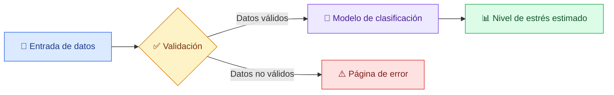

<div align="center">

# 🧠 Predicción del nivel de estrés

### Aprendizaje automático para explorar los factores relacionados con el estrés

Una aplicación web que transforma los datos de un formulario en una estimación del nivel de estrés mediante un modelo de clasificación.

<br>


[](LICENSE)

<br>

[Descripción](#-descripción-general) ·
[Características](#-características) ·
[Instalación](#-instalación-y-ejecución) ·
[Uso](#-uso-de-la-aplicación) ·
[Contribuciones](#-contribuciones)

</div>

---

## 🌿 Descripción general

Este proyecto combina una interfaz web desarrollada con **Flask** y un modelo de aprendizaje automático basado en un **árbol de decisión** para estimar el nivel de estrés a partir de distintos factores introducidos por el usuario.

La aplicación permite completar un formulario, validar los datos y consultar el resultado en una página específica.

> [!NOTE]
> El proyecto necesita el archivo `StressLevelDataset.csv` para entrenar el modelo. Este conjunto de datos no está incluido en el repositorio.

## ✨ Características

| | Característica | Descripción |
| :---: | --- | --- |
| 📝 | Formulario de entrada | Introducción de distintos factores relacionados con el estrés. |
| 🌳 | Modelo de clasificación | Predicción mediante un clasificador basado en un árbol de decisión. |
| 📱 | Diseño adaptable | Interfaz con estilos personalizados para distintos tamaños de pantalla. |
| ✅ | Validación de datos | Comprobación de los valores y de los intervalos admitidos. |
| 🛡️ | Gestión de errores | Página específica para informar sobre entradas no válidas. |
| 📊 | Visualización del resultado | Presentación del nivel de estrés estimado tras procesar el formulario. |

## 🧰 Tecnologías utilizadas

### Lógica y procesamiento de datos

| Tecnología | Función |
| --- | --- |
| 🐍 Python | Lenguaje principal de la aplicación. |
| 🌐 Flask | Servidor web y gestión de rutas. |
| 🤖 scikit-learn | Implementación del modelo de aprendizaje automático. |
| 🐼 pandas | Carga y manipulación del conjunto de datos. |
| 🔢 NumPy | Operaciones numéricas. |

### Interfaz de usuario

| Tecnología | Función |
| --- | --- |
| 🏗️ HTML | Estructura de las páginas y del formulario. |
| 🎨 CSS | Estilos visuales y diseño adaptable. |
| ⚡ JavaScript | Interactividad en el navegador. |

## 📂 Estructura del proyecto

```text
stress-level-predection/
│
├── app.py                       # Aplicación Flask y modelo predictivo
├── StressLevelDataset.csv       # Conjunto de datos; no incluido
│
├── templates/
│   ├── login.html               # Formulario de entrada
│   ├── result.html              # Resultado de la predicción
│   └── error.html               # Página de error
│
└── static/
    └── styles.css               # Estilos de la aplicación
```

> [!NOTE]
> El archivo `login.html` contiene el formulario de entrada. Su nombre no implica que el proyecto ya disponga de autenticación de usuarios; esta función está prevista como mejora.

## 🚀 Instalación y ejecución

### 1. Clona el repositorio

```bash
git clone [https://github.com/venky-1710/stress-level-predection.git](https://github.com/venky-1710/stress-level-predection.git)
cd stress-level-predection
```

### 2. Instala las dependencias

Con Python y pip disponibles en tu equipo, ejecuta:

```bash
pip install flask pandas numpy scikit-learn
```

### 3. Añade el conjunto de datos

Coloca el archivo `StressLevelDataset.csv` en el directorio raíz del proyecto:

```text
stress-level-predection/
├── app.py
└── StressLevelDataset.csv
```

> [!IMPORTANT]
> Debes disponer del conjunto de datos antes de iniciar la aplicación. El archivo debe conservar el nombre esperado y contener las columnas requeridas por `app.py`.

### 4. Inicia la aplicación

```bash
python app.py
```

### 5. Abre la aplicación en el navegador

```text
http://localhost:5000
```

## 🖱️ Uso de la aplicación

| Paso | Acción |
| :---: | --- |
| ① | Accede a la aplicación desde el navegador. |
| ② | Completa el formulario con los factores solicitados. |
| ③ | Respeta el intervalo de valores indicado en cada campo. |
| ④ | Pulsa el botón de envío. |
| ⑤ | Consulta el nivel de estrés estimado en la página de resultados. |

Si los datos introducidos no son válidos, la aplicación mostrará una página de error.

### Flujo de funcionamiento



## 🗃️ Conjunto de datos

El archivo `StressLevelDataset.csv` contiene los datos utilizados para entrenar el modelo.

| Requisito | Detalle |
| --- | --- |
| 📄 Nombre | `StressLevelDataset.csv` |
| 📍 Ubicación | Directorio raíz del proyecto, junto a `app.py`. |
| 📦 Disponibilidad | No incluido en el repositorio. |
| 🧩 Estructura | Debe coincidir con las columnas y el formato que espera la aplicación. |

## ⚠️ Limitaciones y uso responsable

> [!WARNING]
> El resultado es una estimación generada por un modelo de aprendizaje automático. No constituye un diagnóstico clínico ni sustituye la evaluación de un profesional de la salud.

Esta documentación no presenta métricas de rendimiento ni resultados de validación clínica. Por tanto, no atribuye al modelo una precisión determinada ni acredita su uso sanitario.

## 🛠️ Mejoras previstas

- [ ] 🔐 Implementar la autenticación de usuarios.
- [ ] 💾 Incorporar el almacenamiento de datos.
- [ ] 📖 Añadir explicaciones detalladas sobre los factores del formulario.
- [ ] 🧪 Comparar distintos modelos de aprendizaje automático.
- [ ] 📈 Desarrollar una función de seguimiento del nivel de estrés a lo largo del tiempo.

## 🤝 Contribuciones

Las propuestas para mejorar el proyecto son bienvenidas.

### Cómo contribuir

1. 🍴 Crea una copia del repositorio en tu cuenta mediante la opción *Fork*.
2. 🌿 Crea una rama para tus cambios:

   ```bash
   git checkout -b mejora/descripcion-del-cambio
   ```

3. 🛠️ Realiza los cambios y comprueba su funcionamiento.
4. 📝 Registra los cambios:

   ```bash
   git add .
   git commit -m "Describe la mejora realizada"
   ```

5. 📤 Publica la rama:

   ```bash
   git push origin mejora/descripcion-del-cambio
   ```

6. 🔀 Abre una solicitud de incorporación de cambios (*pull request*) y explica tu propuesta.

También puedes comunicar errores o sugerir nuevas funciones en la sección de [incidencias](https://github.com/venky-1710/stress-level-predection/issues).

## 📄 Licencia

Este proyecto se distribuye bajo la [licencia MIT](LICENSE).

Consulta el archivo de licencia para conocer las condiciones de uso, modificación y distribución.

---

<div align="center">

🧠 &nbsp; Aprendizaje automático · Desarrollo web · Análisis de datos

<br>

[⬆ Volver al inicio](#-predicción-del-nivel-de-estrés)

</div>
